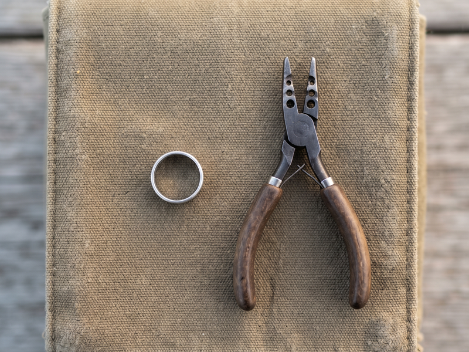

> Depth marker treatment noted first: a marker tied on a sounding line, Baloo Bhaina 2 in dark blue on pale ice.

# cha-missingpatchauditor




# cha-MissingPatchAuditor
Compares installed software versions against a vulnerabilities database and reports on missing security patches.

## Install
```
git clone https://github.com/ShadowGuard-AI/cha-missingpatchauditor
cd cha-missingpatchauditor
pip install -r requirements.txt
```


## Usage

> Dive log entry: Both Paths Are Required. The baseline path and the database path are both required; only the output path is optional.

```
python3 main.py -b BASELINE -d DATABASE [-o OUTPUT]
```


## Parameters
- `-h`: show help message and exit.
- `-b`, `--baseline`: path to the baseline YAML or JSON file, required.
- `-d`, `--database`: path to the vulnerabilities database JSON file, required.
- `-o`, `--output`: path to the output file (optional). If not specified, output prints to stdout.


## Input formats
- Baseline: a JSON or YAML object with a `description` string and a `rules` list. Each rule has `name`, `software`, `installed_version`, `required_version`, and `severity` (`high`, `medium`, or `low`).
- Database: a JSON list of objects, each with `software`, `version`, `cve`, and `description`.


## Verified behavior

> Dive log entry: Exact Match or Silence. A below required install is reported only when a database row matches its installed version as an exact string, as the limit line below states in full.

- A baseline with openssl installed at 1.0.0 and required at 1.1.1, plus a database row for openssl version 1.0.0, reported that missing patch with its CVE, description, and severity.
- A rule already at its required version was not reported.
- With `-o`, the same JSON report was written to the named file.
- A missing input file exits 1, and a baseline or database that fails its schema exits 1.
- Limit, verified by run: a below-required install is reported only when a database row matches its installed version as an exact string. With the database row at version 1.0.1 instead of the installed 1.0.0, the tool printed "No missing patches found." and exited 0.


## License
MIT License, see LICENSE.
